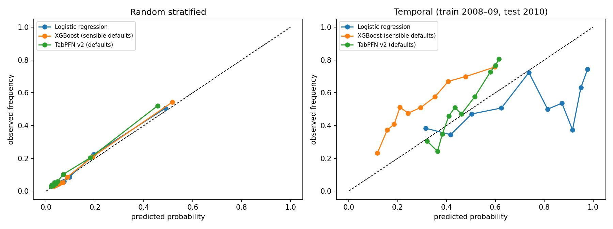
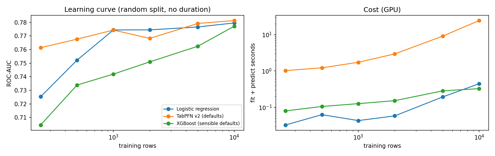
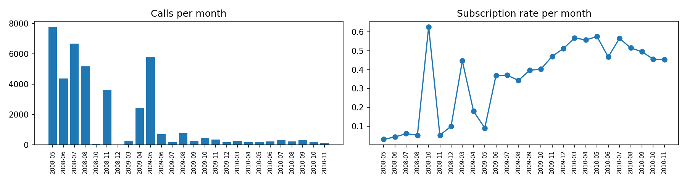

# TabPFN vs. gradient boosting: an honest benchmark

**Built with PriorLabs-TabPFN.** This repo starts from Prior Labs' official [benchmarking example](https://github.com/PriorLabs/TabPFN/blob/main/examples/benchmarking_tabpfn.py), which compares TabPFN and XGBoost on German credit data by ROC-AUC and run time. It reproduces that example, then stress-tests it the way you would before choosing a model for production: confidence intervals, stronger baselines, data leakage, random vs. temporal splits, class imbalance, inference cost and calibration.

**Run it yourself:** click the badge, choose Runtime → Change runtime type → T4 GPU, then Run all. It takes about 15 minutes on Colab's free tier.

## Results in brief

TabPFN v2 with **no tuning at all**:

| Test | TabPFN v2 | Strongest baseline | Difference |
|---|---|---|---|
| German credit, 15-fold repeated CV (ROC-AUC) | **0.801** ± 0.031 | 0.796 (XGBoost) | +0.004; TabPFN won 9 of 15 folds. **Within noise** |
| Bank marketing, random split, 33k training rows | 0.806 | **0.816** (XGBoost) | **−0.010** (95% CI −0.017 to −0.003) |
| Same, XGBoost trained on TabPFN's 10k-row sample | 0.806 | 0.807 | −0.001 (CI −0.008 to +0.007). A tie |
| Bank marketing, **temporal** split (train 2008–09, test 2010) | **0.708** | 0.674 (XGBoost) | **+0.033** (CI +0.013 to +0.054) |
| Calibration error on the temporal split (ECE, lower is better) | **0.089** | 0.200 (logistic regression) | |
| Rolling monthly backtest over 2010, 3-month windows (mean of 9 months) | **0.738** | 0.714 (XGBoost, all history) | +0.024 (no formal test; month-to-month sd ≈ 0.06) |
| 250 training rows (ROC-AUC) | **0.761** | 0.725 (logistic regression) | +0.036, gone by about 1,000 rows |
| Prediction cost with 10k rows of context (T4 GPU) | 11.6 ms per row | **0.01 ms per row** (XGBoost) | About 1,000× slower |

**The honest summary:** untuned TabPFN matched tuned trees on small data. It lost narrowly when the trees could use three times more data than TabPFN's 10k-row context limit allows. It held up best when the future looked different from the past. And it cost about 1,000× more per prediction.

---

## For beginners: what's going on here?

**TabPFN** is a foundation model for spreadsheets. A normal model such as XGBoost *learns from scratch* on your table. TabPFN has already been trained on millions of synthetic tables, so it has a built-in sense of how columns tend to relate to an outcome. When you call `fit`, it doesn't retrain. It reads your training rows as **context**, much like a chatbot reads a prompt, and predicts in one pass. That makes it quick to use and strong on small tables. It also means prediction gets slower as you give it more rows, and there's a cap on how many it can read.

A model winning one benchmark doesn't mean it wins in every situation. This notebook checks six things that change the answer:

| Concept | Plain-English meaning | What we found |
|---|---|---|
| **Uncertainty** | With only 200 test rows, the score could easily have come out differently | On the original split every model's 95% interval is about ±0.075 wide, larger than the gaps between models |
| **Baselines** | Always compare against simple, strong alternatives | Plain logistic regression was within 0.013 of TabPFN on German credit |
| **Leakage** | A column you wouldn't have at prediction time | Call `duration` (only known after the call) lifts *every* model from about 0.81 to about 0.95. It flatters everything and proves nothing |
| **Temporal vs. random split** | Testing on the future, as in real use, vs. a random shuffle | 2010's subscription rate was 52%, against 11% overall. Every model got worse; TabPFN got least worse |
| **Class imbalance** | Only about 11% of calls succeed | "Always say no" is 89% accurate and useless, so we report PR-AUC and precision in the top 10% instead |
| **Inference cost** | How long predictions take | TabPFN's prediction time grows with training size and needs a GPU. Trees predict almost instantly |

---

## Where TabPFN helped, and where it didn't

| Helped | Didn't help, or cost more |
|---|---|
| **Small tables:** best at 250 rows and on 3-month rolling windows of about 750 rows | **Large tables:** v2 reads at most 10k rows; with 33k rows available, XGBoost was significantly better |
| **Shift over time:** best AUC, log loss and calibration on 2010 data | **Prediction cost:** about 1,000× XGBoost per row at 10k context, and it needs a GPU |
| **No tuning and very stable:** seed-to-seed sd of 0.001 AUC | **Calibration on the random split:** it predicted 9.3% vs a true 11.3% (ECE 0.020 vs 0.010 for XGBoost) |
| | **German credit:** best on average, but by less than the noise |

**What this does not show:** *why* TabPFN held up better in 2010. It's one temporal split on one dataset, and the 2010 economic indicators fall outside the training range. A natural next test is to drop the macro indicators and re-run. Nothing here generalises beyond these two datasets.

---

## Method

**Data**
* **German credit:** OpenML 46562, 1,000 applicants, 30% bad credit. The same data as Prior Labs' example.
* **Bank marketing:** UCI `bank-additional-full`, 41,188 calls from May 2008 to Nov 2010, 11.3% subscribed (Moro et al., 2014). The file has no year column, so each call's calendar month is rebuilt from the dataset's monthly CPI and consumer-confidence indicators and its quarterly `nr.employed` value (26 months). The reconstruction is checked against the public 3-month Euribor rate and asserted against the original file's date order.

**Models:** base-rate prior · logistic regression (one-hot + scaling) · XGBoost with Prior Labs' "sensible defaults" · XGBoost with the number of rounds tuned by CV inside each training fold · LightGBM defaults · **TabPFN v2 defaults, no tuning**. When TabPFN's 10k-row context limit forces it to use a sample, XGBoost is also trained on the *same* sample, to separate "better model" from "more data".

**Evaluation**
* Reproduction of the original single split, plus bootstrap 95% CIs and paired bootstrap ΔAUC.
* Repeated stratified 5-fold CV (×3), compared fold by fold.
* Leakage ablation: with and without `duration`.
* Random vs. temporal split, plus a rolling-origin monthly backtest over 2010 (3-month and all-history training windows).
* Metrics: ROC-AUC, PR-AUC, log loss, Brier score, mean predicted vs. observed rate, precision/recall/lift in the top 10%, expected calibration error (ECE), fit and predict time. Seed sensitivity over 3 seeds.

All tables: [`results/summary.md`](results/summary.md). (In table A3, the TabPFN row is compared with itself, so ignore its "wins" column.)

## Reproducing
* Colab: use the badge above (T4 GPU). The first cell installs pinned versions: `tabpfn==10.2.0`, `xgboost==3.4.1`, `lightgbm==4.7.0`.
* Locally: `pip install -r requirements.txt`, then run the notebook. Without a GPU, TabPFN's context is capped at 3,000 rows and results will differ.
* Exact GPU timings and the fourth decimal of TabPFN's scores can vary slightly between runs and hardware.

## Limitations
Two datasets, both binary classification. No regression. Only the open-source **TabPFN-2** weights: later versions, including the library's current default, may behave differently. XGBoost was only lightly tuned (number of rounds). The temporal result rests on one split of one dataset.

## Licence and attribution
* Code in this repo: MIT (see `LICENSE`).
* TabPFN library: Apache-2.0. **TabPFN-2 weights:** Prior Labs License (Apache 2.0 with an additional attribution requirement). This repo selects the v2 weights explicitly because the library's newer default weights are under non-commercial licences. Check the model card before any commercial use.
* Hollmann, N. et al. "Accurate predictions on small data with a tabular foundation model." *Nature* 637, 319–326 (2025).
* Moro, S., Cortez, P. and Rita, P. "A data-driven approach to predict the success of bank telemarketing." *Decision Support Systems* 62, 22–31 (2014).
* Hofmann, H. "Statlog (German Credit Data)." UCI Machine Learning Repository.

*Author: Jeremy Chan. Independent work, not affiliated with Prior Labs.*
